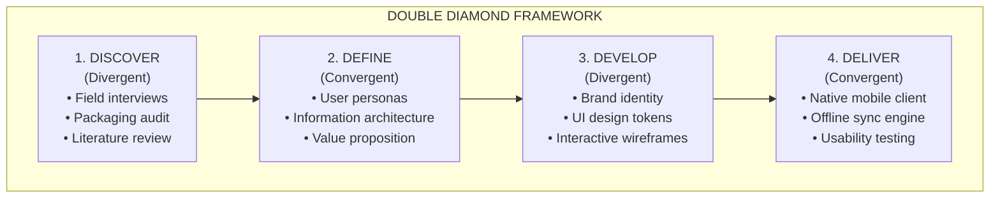
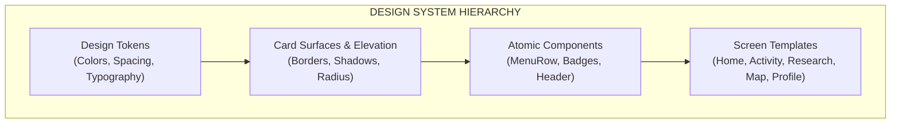
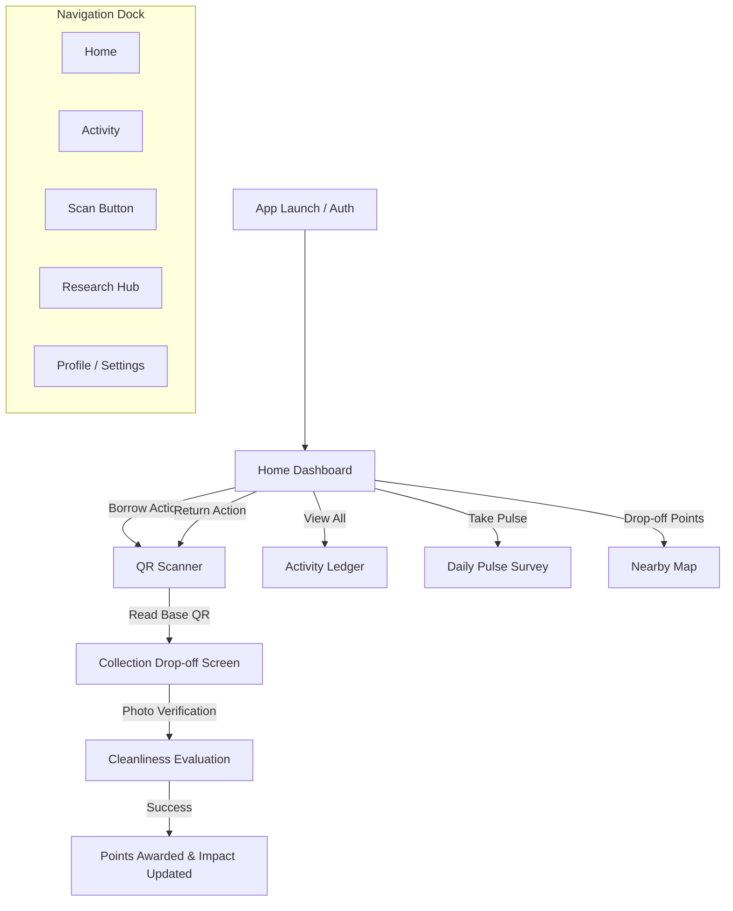

# ReLoop — Software Design Process & Brand Identity Document

---

## 1. Executive Summary & Design Overview

**ReLoop** is a circular-economy mobile platform and academic research instrument designed to eliminate single-use packaging in food-service ecosystems while measuring behavioral adaptation toward **United Nations Sustainable Development Goal 12 (SDG 12: Responsible Consumption and Production)**.

This document presents the complete **Software Design Process Model**, **Brand Identity Genesis**, **Visual Design System**, and **User Experience Architecture** developed throughout the engineering lifecycle of ReLoop.

```mermaid
graph LR
    subgraph Phase 1: Discover
        A1[Problem Space Exploration] --> A2[User Behavioral Friction]
        A2 --> A3[SDG 12 Alignment]
    end
    subgraph Phase 2: Define
        B1[Synthesis & Personas] --> B2[Core Functional Requirements]
        B2 --> B3[Gamification Strategy]
    end
    subgraph Phase 3: Develop
        C1[Naming & Brand Semiotics] --> C2[Design System & Tokens]
        C2 --> C3[High-Fidelity Wireframes]
    end
    subgraph Phase 4: Deliver
        D1[React Native + Expo Engine] --> D2[NestJS + MongoDB Cloud]
        D2 --> D3[Usability & Field Validation]
    end
    Phase 1: Discover --> Phase 2: Define
    Phase 2: Define --> Phase 3: Develop
    Phase 3: Develop --> Phase 4: Deliver
```

---

## 2. The Software Design Process Model

To achieve a seamless synthesis of user-centered design and robust software engineering, the development of ReLoop followed the **Double Diamond Design Process Model** integrated with an **Agile Human-Centered Software Development Lifecycle (HCD-SDLC)**.



### 2.1 Stage 1: Discover (Exploratory Research)
* **Problem Identification:** Single-use takeout packaging creates severe municipal solid waste. Existing deposit-return systems suffer from high cognitive friction, lost deposit cards, and lack of tangible feedback.
* **Target Stakeholders:** Campus students, urban professionals, partner food vendors, sustainability researchers.
* **Key Finding:** Users require immediate, visually quantified positive reinforcement (impact scores, carbon equivalents, streaks) to overcome the habit of single-use convenience.

### 2.2 Stage 2: Define (Product Strategy & Requirements)
* **Functional Pillars:**
  1. **Dual-Scan Tracking:** Seamless QR scanning for container checkouts and localized collection bin drop-offs.
  2. **Tangible Impact Quantification:** Translating abstract plastic counts into liters of water saved and driving kilometers offset.
  3. **Behavioral Research Engine:** Integrated daily micro-surveys (Daily Pulse) and campaign evaluations to generate academic data.
  4. **Offline Resiliency:** An optimistic background sync engine enabling offline scans in low-connectivity areas.

### 2.3 Stage 3: Develop (Visual Architecture & Prototyping)
* **Iterative Prototyping:** From low-fidelity structural sketches to high-fidelity component libraries in React Native.
* **Component-Driven Development:** Standardizing tokens for colors, typography, surfaces, elevations, and animations across light and dark modes.

### 2.4 Stage 4: Deliver & Evaluate (Implementation & Testing)
* **Full-Stack Implementation:** Expo React Native client, NestJS REST backend, MongoDB Atlas, and JWT authentication.
* **Usability Verification:** Field validation of QR scanning speed, overscroll fluidity, camera lens performance, and haptic feedback.

---

## 3. Brand Identity & Nomenclature Development

```
   ┌───────────────────────────────────────────────────────────┐
   │                                                           │
   │      Re          +          Loop       =      ReLoop      │
   │   (Circularity)          (Continuity)      (Closed-Loop)  │
   │                                                           │
   └───────────────────────────────────────────────────────────┘
```

### 3.1 Etymology & Meaning
* **"Re" (Prefix):** Represents the core circular economy imperatives: *Reuse, Return, Recycle, Replenish, Reward*.
* **"Loop" (Noun):** Signifies the *closed-loop circular economy*, where containers remain in perpetual circulation rather than traveling a linear path from vendor to landfill.
* **The Synergistic Meaning:** **ReLoop** stands for "Returning to the Loop" — an empowering, community-driven habit where every returned container closes the loop on plastic pollution.

### 3.2 Tagline & Mission Statement
> **"Closing the Loop on Single-Use Packaging Through Community Action."**

### 3.3 Visual Semiotics & Graphic Identity
* **The Elevated Scan Circle `[ — ]`:** Positioned at the exact geometric center of the navigation dock, the circular emerald scanner button represents the entry portal into the loop.
* **Organic-to-Digital Transition:** Combining organic forest tones (`#0A2E1F`) with vibrant electric emerald (`#10B981`) bridges natural sustainability with modern high-tech convenience.

---

## 4. UI/UX Design System & Aesthetics

ReLoop adopts an ultra-clean, modern mobile design system inspired by top-tier native applications (Apple Health, Linear, Raycast).



### 4.1 Curated Color Palette

| Token Name | Hex Code | Semantic Role |
|:---|:---|:---|
| **Forest Header / Hero** | `#0A2E1F` | Pinned greeting bar, hero card gradient top |
| **Emerald Accent (Primary)** | `#10B981` | Primary CTA buttons, active states, scan ring |
| **Mint Bright** | `#34D399` | Highlights, positive badges, impact metrics |
| **Deep Navy (Dark BG)** | `#0B1120` | Dark mode background canvas |
| **Navy Surface (Dark Card)** | `#151D2E` | Dark mode card container surfaces |
| **Light Canvas (Light BG)** | `#F5F5F7` | Light mode clean native background |
| **Pure Surface (Light Card)** | `#FFFFFF` | Light mode elevated card surfaces |
| **Amber / Gold** | `#F59E0B` / `#FBBF24` | Streak flame, points badges, trophies |
| **Sky Blue** | `#3B82F6` | Offset metrics, information badges, survey tools |

### 4.2 Typography System

ReLoop employs modern grotesque typography with strict optical hierarchy:

* **Hero Metric Numbers (`64pt`, Bold 900):** Provides immediate visual impact for the user's Impact Score.
* **Screen Nav Titles (`17pt`, Semi-Bold 600):** Native iOS/Android standard for pinned navigation headers.
* **Card Titles (`16pt`, Bold 700):** Clear scannability across interactive rows.
* **Secondary Metadata (`12.5pt`, Regular 400):** Muted contrast (`c.textMuted` / `c.textFaint`) to prevent visual overload.

### 4.3 Component Anatomy

```
┌─────────────────────────────────────────────────────────────┐
│ PinnedScreenHeader: Forest Green (#0A2E1F)                  │
│ "WEDNESDAY, SEP 16" · Hi, Gideon       [🔔 9+]  [ (GD) ]   │
├─────────────────────────────────────────────────────────────┤
│ Hero Card (Impact Score: 270)                               │
│  [🌿 IMPACT SCORE]                                          │
│  🔥 3d Streak   ⭐ 154 pts                                  │
├─────────────────────────────────────────────────────────────┤
│ Quick Actions Row:                                          │
│  ┌──────────────────────┐    ┌──────────────────────┐       │
│  │     ⊕ BORROW         │    │     ♻️ RETURN         │       │
│  │   0 active holds     │    │   11 total returns   │       │
│  └──────────────────────┘    └──────────────────────┘       │
├─────────────────────────────────────────────────────────────┤
│ Your Impact Equivalents (Water: 180L, Drive: 4.6km, Bottles)│
├─────────────────────────────────────────────────────────────┤
│ Floating Center Scan Tab Bar: [ ⊞ ] [ ☷ ] [ ( - ) ] [ 📊 ] [ 👤 ]
└─────────────────────────────────────────────────────────────┘
```

---

## 5. Information Architecture & User Flow



---

## 6. Screenshots & Visual Presentation Guide for Thesis/Defense

To present the visual design aspect effectively to the supervisor and examination committee, organize screenshots according to the following figure breakdown:

| Figure # | Title | Description | Key Design Elements to Highlight |
|:---|:---|:---|:---|
| **Figure 4.1** | **Brand Genesis & Design Tokens** | Palette swatches, typography scale, iconography | Contrast ratios, dark/light theme tokens |
| **Figure 4.2** | **Home Dashboard (Light & Dark)** | Side-by-side comparison of Home | Pinned header, Impact Score card, Quick Actions |
| **Figure 4.3** | **Interactive Scanner & Return Flow** | Camera viewfinder with scanning target | High-contrast target box, haptic feedback |
| **Figure 4.4** | **Collection Base & Drop-off Verification** | Drop-off station info & photo upload | Cleanliness check, location metadata |
| **Figure 4.5** | **Activity & Loan Ledger** | Active borrows and transaction history | Overdue indicator chips, timestamped rows |
| **Figure 4.6** | **Research Hub & SDG 12 Analytics** | Campaign scoring and survey charts | Likert scale inputs, platform breakdown pie chart |
| **Figure 4.7** | **Interactive Partner Map** | Map view with filter chips for materials | Custom map pins, distance calculation |
| **Figure 4.8** | **Profile & Account Settings** | Eco profile, reward cards, sign out | Minimalist cards, seamless native spacing |

---

## 7. SDG 12 (Responsible Consumption) Research Integration

ReLoop is intentionally engineered to bridge **software design** with **sustainability science**:

1. **Target 12.5 (Waste Reduction via Reuse):** Quantified in real-time by tracking every container lifecycle from loan to return.
2. **Target 12.8 (Sustainable Lifestyles Awareness):** Implemented via the Daily Pulse survey engine and the Campaign Evaluation module, allowing researchers to measure behavioral shifts across digital and physical touchpoints.

---

*Authored by the ReLoop Engineering & Design Team.*
